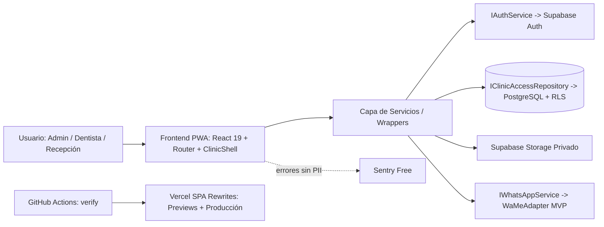

# ARQUITECTURA — DentalCare

Última actualización: 2026-11-26

## Diagrama general

## Principios estructurales
1. **Separación Estricta de Responsabilidades (SoC):**
   - `src/domain/` — Lógica pura (`locale.ts`, `auth.ts`, `money.ts`: formateo exacto en céntimos enteros, cálculo de impuestos `_bps` con `BigInt` half-up, presets multi-país y validaciones). Sin imports de React ni Supabase.
   - `src/services/` — Interfaces y wrappers de servicios externos (`IAuthService`, `IClinicAccessRepository`, `IStorageAdapter`, futuro `IWhatsAppService`). Ni `src/features/` ni `src/ui/` importan `@supabase/supabase-js`.
   - `src/ui/` y `src/features/` — Componentes visuales "tontos" y vistas con tokens semánticos de diseño, traducciones i18n (EN/ES) y manejo de estados Loading / Error / Empty / Overflow.
2. **Inmutabilidad por defecto:** los objetos de estado y cálculos financieros nunca se mutan en sitio.
3. **Dinero e impuestos exactos:** importes en céntimos enteros (`_cents`) y tasas fiscales en puntos básicos enteros (`_bps`, ej. `500` = 5,00%).

## Componentes implementados y previstos

| Pieza | Qué hace | Dónde está |
|---|---|---|
| Configuración de clínica multi-país (`T-04`) | Pantalla `/settings` editable solo por `admin` (`dentist` y `receptionist` en solo lectura en UI y RLS), plantillas rápidas (EAU `AED 5% VAT`, España `EUR 21% IVA`, EE. UU. `USD 0% Tax`), vista previa en vivo al céntimo exacto y actualización instantánea de `ClinicHeader` | `src/features/settings/`, `src/ui/components/ui/select.tsx`, `src/App.tsx` |
| Autenticación, Rutas y Shell (`T-03`) | Flujo de acceso en `/login`, guardia `ProtectedRoute`, `AuthContext` (control de condiciones de carrera, detección de sesión expirada vs. cierre manual, perfil ausente, actualización de `clinic` en memoria y modo degradado sin configurar), `ClinicShell` responsive (sidebar escritorio + drawer móvil accesible) con las 6 rutas de clínica y rewrite SPA en `vercel.json` | `src/features/auth/`, `src/features/shell/`, `src/App.tsx`, `vercel.json` |
| Interfaz PWA + i18n (`T-01`, `T-03`, `T-04`) | Pantallas en EN/ES con tokens semánticos (`src/index.css`), estados base (`LoadingState`, `ErrorState`, `EmptyState`, `MedicalAlertBanner`), sincronización de idioma local + `profiles.preferred_locale` y manifest PWA | `src/ui/`, `src/i18n/`, `public/` |
| Dominio puro (`T-01`, `T-03`, `T-04`) | Idioma (`locale.ts`), reglas de autenticación/rutas (`auth.ts`) y motor financiero multi-país (`money.ts`: `formatMoney`, `calculateTaxCents`, `calculateTaxSummaryCents`, `percentStringToBps`, `bpsToPercentString`, `validateClinicSettings`) | `src/domain/` |
| Wrappers / Servicios (`T-01`–`T-04`) | `IStorageAdapter` (`T-01`), cliente tipado Supabase (`T-02`), `IAuthService` (`SupabaseAuthService`) y `IClinicAccessRepository` (`getActiveClinic`, `getCurrentProfile`, `updatePreferredLocale`, `updateClinicSettings`, `appendAuditLog`) | `src/services/` |
| Esquema y seguridad BD (`T-02`, `T-04`) | Migraciones idempotentes `202611250001_base_schema_rls.sql` y `202611260001_clinic_settings_audit_trigger.sql` (`clinics`, `profiles`, `audit_log`), esquema `private`, triggers `SECURITY INVOKER` anti-escalada/inmutabilidad y auditoría atómica `trg_clinics_30_audit_settings`, RLS + `GRANT` mínimos explícitos y tests reales multi-clínica (`pnpm db:verify`) | `supabase/migrations/`, `supabase/README.md`, `tests/db/` |
| CI automático (`T-01`, `T-02`) | Check único `verify` (`pnpm lint && pnpm typecheck && pnpm test && pnpm db:verify && pnpm build`) con servicio real `postgres:17` | `.github/workflows/ci.yml` |

## Modelo de datos canónico

Todas las tablas de negocio incluyen `clinic_id` (multi-tenant obligatorio) y `deleted_at` (borrado lógico). `audit_log` es inmutable (sin `deleted_at`, solo `INSERT`).

| Tabla | Clave | Columnas principales | Quién puede leer/escribir (RLS) |
|---|---|---|---|
| `clinics` | `id` | `name`, `currency_code`, `currency_symbol`, `tax_rate_bps`, `tax_label`, `timezone`, `default_locale`, `deleted_at` | Lectura: miembros de la clínica · Escritura: solo `admin` de esa clínica |
| `profiles` | `id` (= `auth.users.id`) | `clinic_id`, `full_name`, `role` (`admin` / `dentist` / `receptionist`), `preferred_locale`, `is_active`, `deleted_at` | Lectura: misma clínica · Escritura: propio idioma (`preferred_locale`) o `admin` de la clínica |
| `patients` | `id` | `clinic_id`, `full_name`, `phone`, `email`, `date_of_birth`, `medical_alerts`, `general_notes`, `deleted_at` | Lectura/escritura: roles activos de la misma `clinic_id` |
| `patient_files` | `id` | `clinic_id`, `patient_id`, `appointment_id`, `storage_path`, `file_name`, `mime_type`, `file_size_bytes`, `uploaded_by`, `deleted_at` | Lectura/escritura: misma `clinic_id` (+ RLS en Storage `clinic_id/patient_id/...`) |
| `appointments` | `id` | `clinic_id`, `patient_id`, `dentist_id`, `starts_at`, `ends_at`, `status`, `reason`, `clinical_notes`, `reminder_sent_at`, `deleted_at` | Lectura/escritura: misma `clinic_id` (notas clínicas reservadas a `dentist`/`admin`) |
| `treatments_catalog` | `id` | `clinic_id`, `code`, `name_en`, `name_es`, `category`, `default_price_cents`, `default_duration_min`, `is_active`, `deleted_at` | Lectura: misma `clinic_id` · Escritura: `admin` |
| `quotes` + `quote_items` | `id` | `clinic_id`, `patient_id`, `dentist_id`, `status`, `subtotal_cents`, `tax_rate_bps`, `tax_cents`, `total_cents`, `valid_until`, `deleted_at` | Lectura/escritura: misma `clinic_id` |
| `invoices` + `invoice_items` | `id` | `clinic_id`, `patient_id`, `quote_id`, `invoice_number`, `status`, `currency_code`, `subtotal_cents`, `tax_rate_bps`, `tax_cents`, `total_cents`, `issued_at`, `deleted_at` | Lectura: misma `clinic_id` · Emisión/anulación (`void`): `admin`/`receptionist` |
| `payments` | `id` | `clinic_id`, `invoice_id`, `amount_cents`, `method`, `paid_at`, `reference`, `recorded_by`, `deleted_at` | Lectura/inserción: `admin`/`receptionist` de la misma `clinic_id` |
| `audit_log` | `id` | `clinic_id`, `actor_id`, `action`, `entity_type`, `entity_id`, `metadata_json`, `created_at` | **Inmutable:** solo `INSERT` (automático/controlado) y `SELECT` por `admin` de la misma `clinic_id`; prohibidos `UPDATE` y `DELETE` |

## Flujos importantes
1. **Autenticación y sesión segura (`T-03`):** `ProtectedRoute` redirige usuarios sin sesión a `/login` preservando la ruta interna sanitizada (`sanitizeReturnTo`). Al iniciar sesión vía `IAuthService`, `AuthContext` carga en paralelo `getCurrentProfile` y `getActiveClinic`, sincroniza `preferred_locale` y distingue cierres manuales de expiraciones involuntarias de sesión. Al cambiar EN/ES en el shell, el idioma se guarda tanto localmente como en `public.profiles` enviando únicamente `{ preferred_locale }` para cumplir el trigger `private.guard_profile_update()`.
2. **Aislamiento multi-clínica (`T-02`):** cada sesión obtiene su `clinic_id` y `role` desde `profiles` mediante función SQL segura; las políticas RLS filtran todas las filas antes de salir de PostgreSQL.
3. **Configuración multi-país y auditoría atómica (`T-04`):** `admin` edita en `/settings` las 7 columnas configurables de `public.clinics`; el trigger `trg_clinics_30_audit_settings` (`SECURITY INVOKER`) inserta en la misma transacción una fila inmutable `clinic.settings_updated` en `public.audit_log` con los estados `before` y `after` si hubo cambios reales (sin llamadas duplicadas desde el cliente).
4. **Recordatorio por WhatsApp seguro (`T-09`):** el servicio construirá un mensaje corto con nombre de clínica, fecha y hora (sin diagnóstico, tratamiento ni alertas) y lo entregará a `IWhatsAppService` (`WaMeWhatsAppAdapter` en MVP).
5. **Presupuesto → Factura → Pago (`T-10`–`T-11`):** los totales se calcularán con funciones puras en céntimos enteros (`src/domain/money.ts`), congelando `tax_rate_bps` y precios unitarios en la factura para que cambios futuros en el catálogo no alteren documentos pasados.

## Decisiones
- Ver [docs/adr/0001-stack.md](adr/0001-stack.md)
