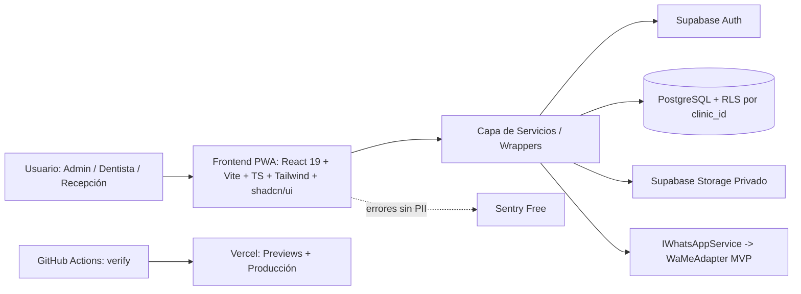

# ARQUITECTURA — DentalCare

Última actualización: 2026-11-25

## Diagrama general

## Principios estructurales
1. **Separación Estricta de Responsabilidades (SoC):**
   - `src/domain/` — Lógica pura (cálculo de presupuestos/facturas en céntimos enteros, validaciones, tipos). Sin imports de React ni Supabase.
   - `src/services/` — Interfaces y wrappers de servicios externos (`IWhatsAppService`, repositorios de datos, storage). Si mañana cambia un proveedor, solo se edita su adaptador.
   - `src/ui/` y `src/features/` — Componentes visuales "tontos" y vistas con tokens semánticos de diseño, traducciones i18n (EN/ES) y manejo de estados Loading / Error / Empty / Overflow.
2. **Inmutabilidad por defecto:** los objetos de estado y cálculos financieros nunca se mutan en sitio.
3. **Dinero e impuestos exactos:** importes en céntimos enteros (`_cents`) y tasas fiscales en puntos básicos enteros (`_bps`, ej. `500` = 5,00%).

## Componentes previstos

| Pieza | Qué hace | Dónde estará |
|---|---|---|
| Interfaz PWA + i18n | Pantallas responsive en EN/ES con tokens semánticos | `src/features/`, `src/ui/`, `src/i18n/` |
| Dominio puro | Cálculos de céntimos/impuestos, reglas de estado de citas y facturas | `src/domain/` |
| Wrappers / Servicios | Acceso a Supabase y conector `IWhatsAppService` (`WaMeAdapter`) | `src/services/` |
| Esquema y seguridad BD | Migraciones SQL, RLS por `clinic_id` y rol, seed sintético | `supabase/migrations/`, `supabase/seed.sql` |
| CI automático | Check único `verify` (lint, tipos, tests, BD, build) | `.github/workflows/ci.yml` |

## Modelo de datos canónico

Todas las tablas de negocio incluyen `clinic_id` (multi-tenant obligatorio) y `deleted_at` (borrado lógico). `audit_log` es inmutable (sin `deleted_at`, solo `INSERT`).

| Tabla | Clave | Columnas principales | Quién puede leer/escribir (RLS) |
|---|---|---|---|
| `clinics` | `id` | `name`, `currency_code`, `currency_symbol`, `tax_rate_bps`, `tax_label`, `timezone`, `default_locale`, `deleted_at` | Lectura: miembros de la clínica · Escritura: solo `admin` de esa clínica |
| `profiles` | `id` (= `auth.users.id`) | `clinic_id`, `full_name`, `role` (`admin` / `dentist` / `receptionist`), `preferred_locale`, `is_active`, `deleted_at` | Lectura: misma clínica · Escritura: propio idioma o `admin` de la clínica |
| `patients` | `id` | `clinic_id`, `full_name`, `phone`, `email`, `date_of_birth`, `medical_alerts`, `general_notes`, `deleted_at` | Lectura/escritura: roles activos de la misma `clinic_id` |
| `patient_files` | `id` | `clinic_id`, `patient_id`, `appointment_id`, `storage_path`, `file_name`, `mime_type`, `file_size_bytes`, `uploaded_by`, `deleted_at` | Lectura/escritura: misma `clinic_id` (+ RLS en Storage `clinic_id/patient_id/...`) |
| `appointments` | `id` | `clinic_id`, `patient_id`, `dentist_id`, `starts_at`, `ends_at`, `status`, `reason`, `clinical_notes`, `reminder_sent_at`, `deleted_at` | Lectura/escritura: misma `clinic_id` (notas clínicas reservadas a `dentist`/`admin`) |
| `treatments_catalog` | `id` | `clinic_id`, `code`, `name_en`, `name_es`, `category`, `default_price_cents`, `default_duration_min`, `is_active`, `deleted_at` | Lectura: misma `clinic_id` · Escritura: `admin` |
| `quotes` + `quote_items` | `id` | `clinic_id`, `patient_id`, `dentist_id`, `status`, `subtotal_cents`, `tax_rate_bps`, `tax_cents`, `total_cents`, `valid_until`, `deleted_at` | Lectura/escritura: misma `clinic_id` |
| `invoices` + `invoice_items` | `id` | `clinic_id`, `patient_id`, `quote_id`, `invoice_number`, `status`, `currency_code`, `subtotal_cents`, `tax_rate_bps`, `tax_cents`, `total_cents`, `issued_at`, `deleted_at` | Lectura: misma `clinic_id` · Emisión/anulación (`void`): `admin`/`receptionist` |
| `payments` | `id` | `clinic_id`, `invoice_id`, `amount_cents`, `method`, `paid_at`, `reference`, `recorded_by`, `deleted_at` | Lectura/inserción: `admin`/`receptionist` de la misma `clinic_id` |
| `audit_log` | `id` | `clinic_id`, `actor_id`, `action`, `entity_type`, `entity_id`, `metadata_json`, `created_at` | **Inmutable:** solo `INSERT` (automático/controlado) y `SELECT` por `admin` de la misma `clinic_id`; prohibidos `UPDATE` y `DELETE` |

## Flujos importantes
1. **Aislamiento multi-clínica:** cada sesión obtiene su `clinic_id` y `role` desde `profiles` mediante función SQL segura; las políticas RLS filtran todas las filas antes de salir de PostgreSQL.
2. **Recordatorio por WhatsApp seguro:** el servicio construye un mensaje corto con nombre de clínica, fecha y hora (sin diagnóstico, tratamiento ni alertas) y lo entrega a `IWhatsAppService` (`WaMeWhatsAppAdapter` en MVP).
3. **Presupuesto → Factura → Pago:** los totales se calculan con funciones puras en céntimos enteros, congelando `tax_rate_bps` y precios unitarios en la factura para que cambios futuros en el catálogo no alteren documentos pasados.

## Decisiones
- Ver [docs/adr/0001-stack.md](adr/0001-stack.md)
