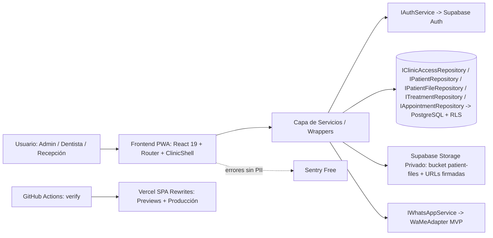

# ARQUITECTURA — DentalCare

Última actualización: 2026-11-28

## Diagrama general

## Principios estructurales
1. **Separación Estricta de Responsabilidades (SoC):**
   - `src/domain/` — Lógica pura (`locale.ts`, `auth.ts`, `money.ts`, `appointments.ts`, `whatsapp.ts`, `patients.ts`, `patientFiles.ts`, `imageOptimization.ts`, `treatments.ts`: formateo y parseo exacto en céntimos enteros `BigInt`, cálculo de impuestos `_bps` half-up, zona horaria IANA de clínica, detección de solapamientos de agenda y KPIs diarios, lista blanca estricta de recordatorios WhatsApp sin datos clínicos y normalización E.164, validación de pacientes/citas/archivos clínicos/tratamientos bilingües, ventana de corrección de 15 min, reglas de optimización de imágenes, construcción de rutas privadas UUID y cálculo puro de edad sin deriva horaria). Sin imports de React ni Supabase.
   - `src/services/` — Interfaces y wrappers de servicios externos (`IAuthService`, `IWhatsAppService` / `WaMeWhatsAppAdapter`, `IImageOptimizer`, `IClinicAccessRepository`, `IPatientRepository`, `IPatientFileRepository`, `ITreatmentRepository`, `IAppointmentRepository`, `IStorageAdapter`). Ni `src/features/` ni `src/ui/` importan `@supabase/supabase-js` ni invocan `getPublicUrl`.
   - `src/ui/` y `src/features/` — Componentes visuales "tontos" y vistas con tokens semánticos de diseño, traducciones i18n (EN/ES) y manejo de estados Loading / Error / Empty / Overflow.
2. **Inmutabilidad por defecto:** los objetos de estado y cálculos financieros nunca se mutan en sitio.
3. **Dinero e impuestos exactos:** importes en céntimos enteros (`_cents`) y tasas fiscales en puntos básicos enteros (`_bps`, ej. `500` = 5,00%).

## Componentes implementados y previstos

| Pieza | Qué hace | Dónde está |
|---|---|---|
| Recordatorios WhatsApp y Botón Rápido Agendar Cita (`T-09`) | Dominio puro con lista blanca estricta (solo nombre de pila, clínica, fecha y hora — cero datos clínicos/motivos/alertas) y normalización E.164 (`whatsapp.ts`), contrato agnóstico `IWhatsAppService` + `WaMeWhatsAppAdapter` (0 USD, preservando gesto de usuario móvil y con respaldo si se bloquea el popup), `markReminderSent` en `IAppointmentRepository`, botón e insignia `Recordatorio enviado` en `AppointmentCard` y `TodaySummaryPanel`, y flujo de 1 clic **Agendar cita** desde `PatientsPage` (banner tras alta), `PatientDetailPage` y `PatientAppointmentsSection` hacia `/schedule?newAppointment=1&patientId=<id>` con validación de clínica y limpieza de URL | `src/domain/whatsapp.ts`, `src/services/whatsapp/whatsappService.ts`, `src/features/schedule/WhatsAppServiceContext.tsx`, `src/features/schedule/AppointmentReminderControls.tsx`, `src/features/schedule/`, `src/features/patients/`, `src/services/repositories/appointmentRepository.ts` |
| Agenda de Citas, Notas Clínicas y Panel del Día (`T-08`) | Pantalla `/schedule` con panel **"Hoy en la clínica"** (KPIs de citas hoy, confirmadas, pendientes, en consulta/completadas y próxima cita siempre anclados a `clinic.timezone`), vista Día/Semana, filtros por dentista y estado, detección en vivo de solapamientos para el mismo dentista con confirmación explícita, notas clínicas por visita exclusivas de `dentist`/`admin` (enforced en BD y UI; `receptionist` nunca proyecta ni edita `clinical_notes`), archivado lógico + pestaña Archivadas con restauración para `admin` y sección compacta de citas en `/patients/:patientId` | `src/features/schedule/`, `src/features/patients/PatientAppointmentsSection.tsx`, `src/domain/appointments.ts`, `src/services/repositories/appointmentRepository.ts`, `src/App.tsx` |
| Catálogo de Tratamientos (`T-07`) | Pantalla `/treatments` con precios en céntimos enteros (`bigint`), nombres bilingües EN/ES, categorías traducidas y vista previa en vivo con moneda/impuesto de la clínica; CRUD completo + pestañas Activos/Archivados con confirmación en UI para `admin`, y vista de solo lectura con buscador y filtro de categoría para `dentist`/`receptionist` | `src/features/treatments/`, `src/domain/treatments.ts`, `src/domain/money.ts`, `src/services/repositories/treatmentRepository.ts`, `src/App.tsx` |
| Archivos Clínicos Privados, Archivados y Purga (`T-06`, `T-06b`) | Galería y subida segura (`PatientFilesSection`, `PatientFileCard`, `ArchivedPatientFileCard`) dentro de `/patients/:patientId` para fotos intraorales y radiografías sintéticas (`JPG`/`PNG`/`WEBP`/`PDF`, máx. 10 MB), optimización inteligente en cliente (`IImageOptimizer` / `BrowserCanvasImageOptimizer` con casilla *"Mantener calidad original"*), botón Reemplazar (sube primero y archiva después), eliminación de subida propia por error dentro de 15 min, pestañas Activos/Archivados para `admin` con restauración y purga controlada de Storage (`purged_at` inmutable + auditoría sin PII) | `src/features/patients/`, `src/domain/patientFiles.ts`, `src/domain/imageOptimization.ts`, `src/services/media/imageOptimizer.ts`, `src/services/repositories/patientFileRepository.ts`, `src/App.tsx` |
| Pacientes, Alertas Críticas y Archivados (`T-05`, `T-06b`) | Listado `/patients` con buscador instantáneo sin tildes, tarjetas responsive móvil sin corte del nombre, pestañas Activos/Archivados + restauración con confirmación para `admin` (`ArchivedPatientCard`), alta/edición con aviso sintético (`PatientForm`), ficha `/patients/:patientId` con cabecera responsive móvil, `MedicalAlertBanner` rojo de alto contraste + icono en la parte superior y archivado lógico (`deleted_at`) auditado sin PII | `src/features/patients/`, `src/ui/components/ui/textarea.tsx`, `src/App.tsx` |
| Configuración de clínica multi-país (`T-04`) | Pantalla `/settings` editable solo por `admin` (`dentist` y `receptionist` en solo lectura en UI y RLS), plantillas rápidas (EAU `AED 5% VAT`, España `EUR 21% IVA`, EE. UU. `USD 0% Tax`, Venezuela `USD 0% IVA` y `VES Bs. 16% IVA`), vista previa en vivo al céntimo exacto y actualización instantánea de `ClinicHeader` | `src/features/settings/`, `src/ui/components/ui/select.tsx`, `src/App.tsx` |
| Autenticación, Rutas y Shell (`T-03`) | Flujo de acceso en `/login`, guardia `ProtectedRoute`, `AuthContext` (control de condiciones de carrera, detección de sesión expirada vs. cierre manual, perfil ausente, actualización de `clinic` en memoria y modo degradado sin configurar), `ClinicShell` responsive (sidebar escritorio + drawer móvil accesible) con las 6 rutas de clínica y rewrite SPA en `vercel.json` | `src/features/auth/`, `src/features/shell/`, `src/App.tsx`, `vercel.json` |
| Interfaz PWA + i18n (`T-01`, `T-03`–`T-05`) | Pantallas en EN/ES con tokens semánticos (`src/index.css`), estados base (`LoadingState`, `ErrorState`, `EmptyState`, `MedicalAlertBanner`), sincronización de idioma local + `profiles.preferred_locale` y manifest PWA | `src/ui/`, `src/i18n/`, `public/` |
| Dominio puro (`T-01`, `T-03`–`T-09`) | Idioma (`locale.ts`), reglas de autenticación/rutas (`auth.ts`), motor financiero multi-país (`money.ts` con `moneyStringToCents`/`centsToInputString` en `BigInt`), agenda y solapamientos en zona horaria IANA (`appointments.ts`), recordatorios WhatsApp sin datos clínicos y normalización E.164 (`whatsapp.ts`), dominio de pacientes (`patients.ts`), archivos clínicos (`patientFiles.ts`, `imageOptimization.ts`) y catálogo de tratamientos (`treatments.ts`) | `src/domain/` |
| Wrappers / Servicios (`T-01`–`T-09`) | `IStorageAdapter` (`T-01`), cliente tipado Supabase (`T-02`), `IAuthService` (`SupabaseAuthService`), `IWhatsAppService` (`WaMeWhatsAppAdapter` a coste 0 USD, `T-09`), `IClinicAccessRepository`, `IPatientRepository`, `IPatientFileRepository` (`SupabasePatientFileRepository` con `upsert: false`, `createSignedUrl` acotado ≤ 300 s, cero `getPublicUrl`), `ITreatmentRepository` (`SupabaseTreatmentRepository` con mapeo defensivo y preservación segura de `23505`) e `IAppointmentRepository` (`SupabaseAppointmentRepository` con proyección consciente de privacidad para recepción, `markReminderSent` y archivado/restauración puros) | `src/services/` |
| Esquema y seguridad BD (`T-02`, `T-04`–`T-08`) | Migraciones idempotentes `202611250001_base_schema_rls.sql`, `202611260001_clinic_settings_audit_trigger.sql`, `202611260002_patients_rls.sql`, `202611260003_patient_files_storage_rls.sql`, `202611270001_archive_restore_purge_rls.sql`, `202611270002_treatments_catalog_rls.sql` y `202611280001_appointments_rls.sql` (`clinics`, `profiles`, `patients`, `patient_files`, `appointments`, `treatments_catalog`, `audit_log` + bucket privado `patient-files`), esquema `private`, triggers `SECURITY INVOKER` anti-spoofing/inmutabilidad/archivado puro/protección de notas clínicas y tests reales multi-clínica (`pnpm db:verify`) | `supabase/migrations/`, `supabase/README.md`, `tests/db/` |
| CI automático (`T-01`, `T-02`) | Check único `verify` (`pnpm lint && pnpm typecheck && pnpm test && pnpm db:verify && pnpm build`) con servicio real `postgres:17` | `.github/workflows/ci.yml` |

## Modelo de datos canónico

Todas las tablas de negocio incluyen `clinic_id` (multi-tenant obligatorio) y `deleted_at` (borrado lógico). `audit_log` es inmutable (sin `deleted_at`, solo `INSERT`).

| Tabla | Clave | Columnas principales | Quién puede leer/escribir (RLS) |
|---|---|---|---|
| `clinics` | `id` | `name`, `currency_code`, `currency_symbol`, `tax_rate_bps`, `tax_label`, `timezone`, `default_locale`, `deleted_at` | Lectura: miembros de la clínica · Escritura: solo `admin` de esa clínica |
| `profiles` | `id` (= `auth.users.id`) | `clinic_id`, `full_name`, `role` (`admin` / `dentist` / `receptionist`), `preferred_locale`, `is_active`, `deleted_at` | Lectura: misma clínica · Escritura: propio idioma (`preferred_locale`) o `admin` de la clínica |
| `patients` | `id` | `clinic_id`, `full_name`, `phone`, `email`, `date_of_birth`, `medical_alerts`, `general_notes`, `deleted_at` | Lectura/escritura/archivado lógico (`deleted_at`): roles activos de la misma `clinic_id` (prohibido `DELETE` físico; archivado auditado sin PII) |
| `patient_files` | `id` | `clinic_id`, `patient_id`, `appointment_id`, `storage_path`, `file_name`, `mime_type`, `file_size_bytes`, `uploaded_by`, `deleted_at`, `purged_at` | Lectura/escritura: misma `clinic_id` (+ RLS en Storage `clinic_id/patient_id/...`); archivados/restauración/purga definitiva solo `admin`, más ventana de 15 min del autor sobre subidas propias por error (`purged_at` inmutable) |
| `appointments` | `id` | `clinic_id`, `patient_id`, `dentist_id`, `starts_at`, `ends_at`, `status`, `reason`, `clinical_notes`, `reminder_sent_at`, `deleted_at` | Lectura/escritura: misma `clinic_id` (notas clínicas reservadas a `dentist`/`admin`) |
| `treatments_catalog` | `id` | `clinic_id`, `code`, `name_en`, `name_es`, `category`, `default_price_cents`, `default_duration_min`, `is_active`, `deleted_at` | Lectura: misma `clinic_id` · Escritura: `admin` |
| `quotes` + `quote_items` | `id` | `clinic_id`, `patient_id`, `dentist_id`, `status`, `subtotal_cents`, `tax_rate_bps`, `tax_cents`, `total_cents`, `valid_until`, `deleted_at` | Lectura/escritura: misma `clinic_id` |
| `invoices` + `invoice_items` | `id` | `clinic_id`, `patient_id`, `quote_id`, `invoice_number`, `status`, `currency_code`, `subtotal_cents`, `tax_rate_bps`, `tax_cents`, `total_cents`, `issued_at`, `deleted_at` | Lectura: misma `clinic_id` · Emisión/anulación (`void`): `admin`/`receptionist` |
| `payments` | `id` | `clinic_id`, `invoice_id`, `amount_cents`, `method`, `paid_at`, `reference`, `recorded_by`, `deleted_at` | Lectura/inserción: `admin`/`receptionist` de la misma `clinic_id` |
| `audit_log` | `id` | `clinic_id`, `actor_id`, `action`, `entity_type`, `entity_id`, `metadata_json`, `created_at` | **Inmutable:** solo `INSERT` (automático/controlado) y `SELECT` por `admin` de la misma `clinic_id`; prohibidos `UPDATE` y `DELETE` |

## Flujos importantes
1. **Autenticación y sesión segura (`T-03`):** `ProtectedRoute` redirige usuarios sin sesión a `/login` preservando la ruta interna sanitizada (`sanitizeReturnTo`). Al iniciar sesión vía `IAuthService`, `AuthContext` carga en paralelo `getCurrentProfile` y `getActiveClinic`, sincroniza `preferred_locale` y distingue cierres manuales de expiraciones involuntarias de sesión. Al cambiar EN/ES en el shell, el idioma se guarda tanto localmente como en `public.profiles` enviando únicamente `{ preferred_locale }` para cumplir el trigger `private.guard_profile_update()`.
2. **Aislamiento multi-clínica (`T-02`):** cada sesión obtiene su `clinic_id` y `role` desde `profiles` mediante función SQL segura; las políticas RLS filtran todas las filas antes de salir de PostgreSQL.
3. **Configuración multi-país y auditoría atómica (`T-04`):** `admin` edita en `/settings` las 7 columnas configurables de `public.clinics`; el trigger `trg_clinics_30_audit_settings` (`SECURITY INVOKER`) inserta en la misma transacción una fila inmutable `clinic.settings_updated` en `public.audit_log` con los estados `before` y `after` si hubo cambios reales (sin llamadas duplicadas desde el cliente).
4. **Ficha de paciente, alertas críticas en rojo y archivado sin PII (`T-05`):** los roles activos consultan y buscan pacientes de su clínica en `/patients` mediante `IPatientRepository` y `filterPatientsByQuery` (evitando inyección de sintaxis en `.or()` de PostgREST). Al abrir `/patients/:patientId`, `MedicalAlertBanner` se renderiza siempre en la parte superior con contraste alto e icono cuando `hasCriticalMedicalAlerts` es `true`. El archivado ejecuta `UPDATE ... SET deleted_at = now()` sin encadenar `.select()` y dispara `trg_patients_30_audit_archive`, que inserta `patient.archived` con `metadata_json = '{}'` (cero PII).
5. **Fotos intraorales y radiografías sintéticas en Storage privado, optimización y purga controlada (`T-06`, `T-06b`):** `PatientFilesSection` valida en cliente (`validatePatientFileUpload`) antes de optimizar imágenes grandes (`> 1 MB` / `> 2048 px`) con `IImageOptimizer` (respetando *"Mantener calidad original"* para radiografías y dejando PDFs intactos), revalida, sube con `upsert: false` a `<clinic_id>/<patient_id>/<uuid>.<ext>` en el bucket privado `patient-files` y registra metadatos en `public.patient_files` (con `trg_patient_files_05_enforce_defaults` evitando falsificar `created_at`). Toda vista previa o apertura usa únicamente `createSignedUrl` con TTL ≤ 300 s (cero `getPublicUrl`). El botón Reemplazar sube el archivo nuevo primero y solo archiva el anterior tras éxito. Para liberar espacio sin borrar filas históricas, `storage.remove()` (verificando `removedData.length > 0`) + `purged_at` está autorizado en RLS exclusivamente para `admin` sobre archivos archivados o el propio autor dentro de 15 minutos, registrando `patient_file.purged` (`metadata_json = '{}'`) y sellando la fila como permanentemente inmutable.
6. **Agenda de citas, notas clínicas por visita y panel del día (`T-08`):** `SchedulePage` (`/schedule`) mantiene el panel *"Hoy en la clínica"* siempre anclado al día actual en `clinic.timezone` (incluso al navegar por otras fechas o semanas), detecta solapamientos en tiempo real para el mismo dentista (`findOverlappingAppointments`, excluyendo citas contiguas, canceladas y no-show) y exige confirmación explícita si el usuario decide guardar un solapamiento. En PostgreSQL, `public.appointments` usa FKs compuestas `(clinic_id, patient_id)` y `(clinic_id, dentist_id)` (enlazada además desde `public.patient_files.appointment_id`), guarda de transición `private.appointment_archive_transitions` (PG 17 `WCO_RLS_CONFLICT_CHECK`), triggers fail-closed que bloquean cualquier escritura de `clinical_notes` por `receptionist` (`42501`), normalizan `reminder_sent_at` al reloj del servidor y registran auditoría atómica estrictamente libre de PII/datos clínicos (`appointment.created`, `status_changed`, `clinical_notes_updated`, `rescheduled`, `reminder_sent`, `archived`, `restored`). En cliente, `SupabaseAppointmentRepository` omite `clinical_notes` en las proyecciones `.select(...)` e inserciones de `receptionist`.
   - **Nota obligatoria para Nivel de riesgo 4 (`T-14`):** en Supabase todos los roles de clínica comparten el rol PostgreSQL `authenticated`, por lo que RLS filtra filas y el trigger/repositorio impiden escritura y proyección UI de `clinical_notes` para `receptionist`. Antes de admitir datos reales de pacientes (Nivel de riesgo 4), para impedir también que un `receptionist` lea `clinical_notes` consultando PostgREST directamente con su propio JWT, se deberá separar `clinical_notes` a una tabla dedicada (`appointment_clinical_notes`) con política RLS `FOR SELECT`/`INSERT`/`UPDATE` exclusiva para `dentist`/`admin`.
7. **Recordatorio por WhatsApp seguro y botón rápido "Agendar cita" (`T-09`):** `buildSafeAppointmentReminderPayload` aplica una lista blanca estricta (solo nombre de pila, nombre de la clínica, fecha y hora en `clinic.timezone`, excluyendo estructuralmente apellidos, alertas médicas, motivo, notas clínicas, correo y fecha de nacimiento) y normaliza teléfonos a dígitos E.164. `WaMeWhatsAppAdapter` (`IWhatsAppService`, coste 0 USD) abre `https://wa.me/...` de forma síncrona antes de cualquier `await` para preservar el gesto de usuario en móvil; si el navegador bloquea el popup, muestra un enlace directo de respaldo. Al abrirse el enlace, `appointmentRepo.markReminderSent` envía únicamente `{ reminder_sent_at }` (normalizado a `pg_catalog.now()` y auditado como `appointment.reminder_sent` sin PII en PostgreSQL) respetando `includeClinicalNotes`. Además, tras registrar un paciente en `PatientsPage` (y desde `PatientDetailPage` / `PatientAppointmentsSection`), el botón rápido **Agendar cita** navega a `/schedule?newAppointment=1&patientId=<id>`, donde `SchedulePage` valida que el paciente pertenezca a la clínica activa, preselecciona el formulario y limpia la URL (`replace: true`).
8. **Presupuesto → Factura → Pago (`T-10`–`T-11`):** los totales se calcularán con funciones puras en céntimos enteros (`src/domain/money.ts`), congelando `tax_rate_bps` y precios unitarios en la factura para que cambios futuros en el catálogo no alteren documentos pasados.

## Decisiones
- Ver [docs/adr/0001-stack.md](adr/0001-stack.md)
